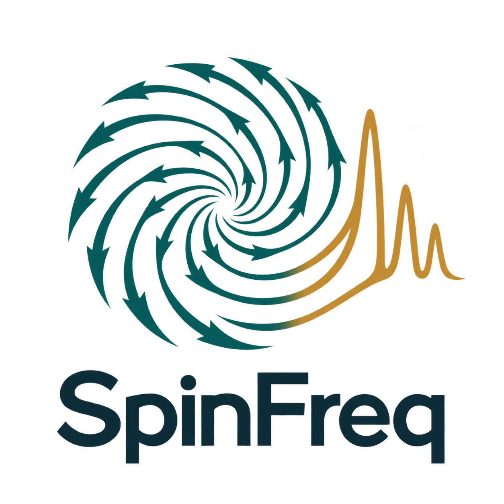

<p align="center"></p>

# SpinFreq

**Explore how magnetic films and skyrmions resonate.** SpinFreq is a CPU Python
simulator for thin-film equilibria, natural modes and weak-field frequency response.
Use experiment files and local commands, or the optional browser interface.
Current research candidate: **0.1.0rc2**, MIT licensed.

Release preparation: [candidate checks, downloads and remaining publication steps](docs/releases/CANDIDATE.md).

**New here? [Start with your first spectrum](docs/getting-started/README.md).**
You need 64-bit Python 3.11–3.13. No GPU, MuMax3 or Linux subsystem is needed for
the local CPU demo. Download the [source ZIP](https://github.com/spinuni/spinfreq/archive/refs/heads/main.zip)
and extract it, or clone this repository.

## Your first result

On **Windows**, open the extracted `windows` folder and double-click
**Install.cmd**, then **Run-Demo.cmd**. The helper creates a local `.venv`,
installs dependencies and opens the result after calculation. See the
[Windows instructions](windows/README.md) for the equivalent terminal commands.

On **Linux or macOS**, open a terminal in the extracted repository:

```bash
python3 -m venv .venv
.venv/bin/python -m pip install -e .
.venv/bin/spinfreq-doctor --check
.venv/bin/spinfreq-demo --open
```

The demo prints its results folder. Open `spectrum.png` to see absorption versus
frequency, and keep `configuration.json` and `results.zip` to reproduce the run.
Repeated demos create new folders and preserve previous results. It is a fast
single-cell example; spatial films and skyrmions are the next steps.

The installed package also includes eight editable experiments. Run
`spinfreq-examples --list`, then
`spinfreq-examples --name localized-source --output my-experiment`.
It creates a configuration, a guide and `run.py`, and prints the exact command
for your Python environment. You can run these examples outside the checkout.

## Choose your next experiment

| I want to… | Start here |
| --- | --- |
| Understand the plots, units and basic commands | [First-result tutorial](docs/getting-started/README.md) |
| Try a film or a confined skyrmion | [Example gallery](examples/README.md) |
| Place a source and detector or select a wavevector | [Spatial spectroscopy](docs/guides/SPECTROSCOPY.md) |
| Sweep a field/material or reuse a saved texture | [Research workflows](docs/guides/RESEARCH.md) |
| Follow mode shapes across a sweep | [Mode matching and ambiguity](docs/guides/MODE_TRACKING.md) |
| Compare x/y/z fields and inspect modal coupling | [Polarization tensors](docs/guides/SUSCEPTIBILITY.md) |
| Script a custom calculation | [Python and CLI manual](docs/guides/USAGE.md) |

Optional browser interface: install `.[web]`, run `spinfreq-web`, then open
**http://127.0.0.1:8000**. Windows defaults to configuration preview; local CPU
commands still run. Protected native Windows browser computation is an explicit
experimental option with qualification pending. Linux/WSL2 enables the queue
automatically; macOS offers browser preview. See the [web guide](docs/guides/WEB.md).

## Understand and trust the calculation

- [Theory and numerical methods](docs/reference/PHYSICS.md): equations, conventions and model scope.
- [Validation evidence](validation/README.md): analytical tests and independent temporal-solver comparisons, with data and plots.
- [Research priorities](docs/development/RESEARCH_ROADMAP.md): what is implemented and what remains to develop.

All current models use one magnetization vector through thickness. Frequency
response is linear and dense problems have resource limits. Refine the mesh and
check numerical diagnostics before quoting research results. Nonlinear combs,
current-induced torques and general thickness-dependent modes remain outside
this workflow's validated scope.

## Find your way around

```text
examples/      Experiments to run and adapt
windows/       Windows source-install and first-run helpers
docs/          Start here → usage → theory → research/development
spinfreq/      Numerical library, local commands and optional browser interface
benchmarks/    Reproduction scripts for scientific comparisons
validation/    Accepted data, plots and provenance
```

The [documentation map](docs/README.md) contains the full reading order.
For development, see [contributing](CONTRIBUTING.md), [architecture](docs/development/ARCHITECTURE.md),
[release milestones](docs/releases/RELEASE_PLAN.md), [changelog](CHANGELOG.md)
and [citation](CITATION.cff). Package publication and hosted deployment are
separate from installing this source candidate.
