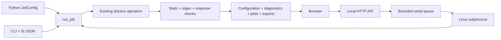

# Repository and execution architecture

| Path | Responsibility |
| --- | --- |
| `spinfreq/model.py`, `confined.py`, `bloch.py` | Periodic spectral, finite FD/Newell and Bloch-chain physics |
| `spinfreq/linear_response.py`, `equilibrium.py`, `dynamics.py`, `ovf.py` | Reusable modal response, static refinement, temporal integration and interchange |
| `spinfreq/config.py` | Strict versioned SI configuration, presets and web computation bounds |
| `spinfreq/jobs.py` | Shared reproducible job, diagnostics, plots and exports |
| `spinfreq/cli.py` | CLI adapter; no independent physics implementation |
| `spinfreq/web/`, `worker.py` | Browser/API, queue supervisor and bounded Linux subprocess |
| `examples/` | Checked-in runnable configurations |
| `scripts/` | Application/preset/browser release checks |
| `benchmarks/` | Independent scientific comparisons and reference acquisition |
| `validation/` | Accepted evidence, provenance, CSVs, plots and native reference archives |
| `tests/` | Analytical physics, reference-analysis, configuration and job-lifecycle regressions |
| `docs/`, `.github/workflows/` | Documentation and automated build/validation checks |
| `results/`, `build/`, `dist/` | Ignored exploratory, runtime and packaging outputs |

Benchmark scripts retain their existing paths because shared imports and published
reproduction commands depend on them. Their new index groups them by scientific
purpose. New application code is separated from the numerical operators.

The HTTP process never performs dense eigenanalysis. One supervisor owns a data
directory and starts one worker at a time. Worker memory/CPU/file limits, a wall
alarm and supervisor disk checks bound computation. Linux parent-death handling
terminates a worker when its server dies. Startup marks unfinished records
`interrupted`; it does not silently rerun them. The lifecycle is
`queued -> running -> succeeded/failed/cancelled`; restart can produce `interrupted`.

`run_job` refines static torque, constructs the full modal basis, checks numerical
growth signs and eigen residuals, then solves the forced response with true
residual checks. Unstable/uncertain equilibria or predicted `max |delta m| > 0.05`
fail before spectra are exposed. The growth-sign margin is conservative numerical
screening, not a rigorous near-neutral or continuum stability certificate.

Successful exports include configuration and solver-source SHA-256 hashes,
package/dependency versions, tolerances, thread settings, residuals and measured
process resources. `manifest.json` hashes the files in `results.zip`; the manifest
and zip cannot include their own hashes. Python can also call the lower-level
physics APIs for larger research workflows outside the first web scope.
