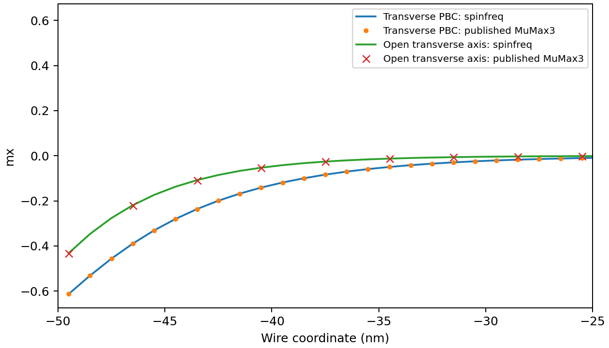
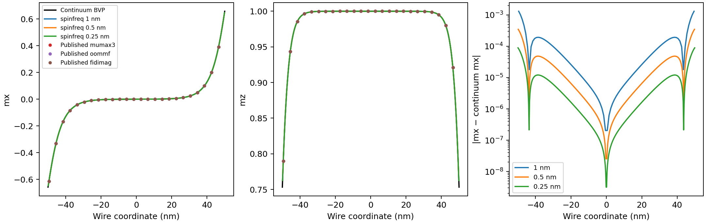
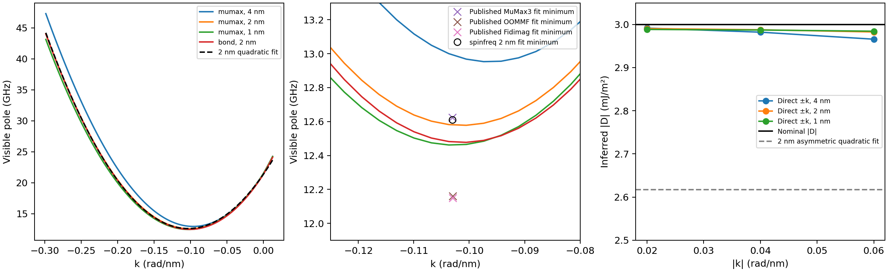
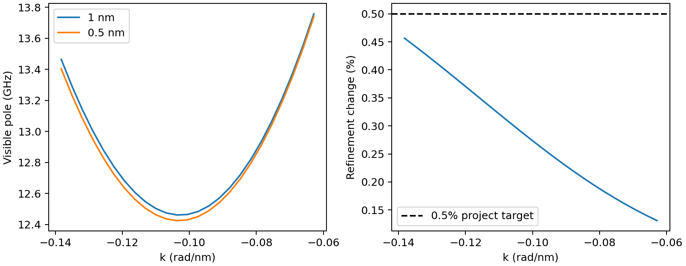

# Interfacial DMI standard problem: static profiles and signed dispersion

Reference: D. Cortés-Ortuño et al., *Proposal for a micromagnetic standard
problem for materials with Dzyaloshinskii–Moriya interaction*, New Journal of
Physics **20**, 113015 (2018),
[DOI](https://doi.org/10.1088/1367-2630/aaea1c).
[Author data and inputs](https://github.com/fangohr/paper-supplement-standard-problem-dmi),
[dataset DOI](https://doi.org/10.5281/zenodo.1174311).

This report validates the **interfacial 1D static problem** pointwise against
published MuMax3, OOMMF and Fidimag profiles. For propagation it compares a
linear Bloch-strip calculation with the authors' **saved dispersion-fit
summaries**, checks signed nonreciprocity analytically, and examines mesh and
image convergence. These are different levels of evidence. Raw temporal f–k
arrays are absent from the pinned source repository; a complete independent
temporal-dispersion validation remains open.

## Reproduce

From a source checkout installed with `pip install -e '.[test]'`:

```bash
OPENBLAS_NUM_THREADS=1 OMP_NUM_THREADS=1 \
  python benchmarks/dmi_standard_problem.py --fetch-reference --check
```

Reference files (~0.8 MB) are downloaded only when requested, into
`results/reference/dmi2018/`. The script checks each SHA-256 hash and pins the
author commit `1d9390c06c13cda29b0eb2f38f7e132be05e97f4`. It reads saved notebook
text outputs without executing any notebook code.

Alternatively use an author checkout:

```bash
OPENBLAS_NUM_THREADS=1 OMP_NUM_THREADS=1 \
  python benchmarks/dmi_standard_problem.py \
  --reference-directory /path/to/paper-supplement-standard-problem-dmi --check
```

For the smaller static/analytical regression used in CI:

```bash
OPENBLAS_NUM_THREADS=1 OMP_NUM_THREADS=1 \
  python benchmarks/dmi_standard_problem.py --fetch-reference \
  --skip-dispersion --check --output results/dmi_static_check
```

`--skip-dispersion` records `dispersion: null`; its successful exit certifies
only the executed checks. `--check` returns a failure when an executed project
acceptance criterion fails. Use `--output results/dmi_experiment` for exploratory
runs so that a failed calculation cannot be confused with tracked results.
The full calculation takes several minutes on a CPU; wall times are recorded.

## 1. Single-cell axes and boundary conditions

The models now accept positive integer `nx,ny`, including 1 and 2. Sampled-field
derivative diagnostics return zero along singleton axes. Bloch phase across a
one-cell period still contributes exchange and DMI at nonzero k. A two-cell finite-difference
diagnostic uses first-order boundary differences. The energy and field
operators retain their own exchange/DMI stencils.

**An open singleton axis retains both MuMax ghost boundaries.** Its two missing
neighbors are physical boundary conditions in that discretization; they do not
disappear because the resolved derivative is zero.

The standard wire is 100×1×1 nm, with `Ms=0.86 MA/m`, `A=13 pJ/m`,
`K=0.4 MJ/m³`, easy z and demag disabled. The paper's MuMax comparison uses
`SetPBC(0,1,0)` across the transverse y direction. The supplied no-PBC input and
its profile are a separate comparison in the author notebook.

To represent this using the existing x-periodic/open-y `BlochChain`, rotate
the reference wire by 90° about z:

```python
import numpy as np
from spinfreq import BlochChain, Material, refine_equilibrium

wire = BlochChain(nx=1, ny=100, dx=1e-9, dy=1e-9, thickness=1e-9,
                 images=1, demag=False, field_T=(0, 0, 0),
                 material=Material(Ms=.86e6, A=13e-12, D=-3e-3, K=.4e6))
initial = np.zeros(wire.shape)
initial[..., 2] = 1
state = refine_equilibrium(wire, wire.relax(initial).m, tolerance_T=1e-8)
mx_reference = state.m[:, 0, 1]
mz_reference = state.m[:, 0, 2]
```

The long wire is open along model y; its short transverse direction is periodic
along model x. The inverse vector rotation is
`m_reference=(m_model_y, -m_model_x, m_model_z)`. With demag disabled, image
count has no magnetic effect here. A finite `ConfinedFilm(nx=100,ny=1)` instead
represents the separate **open-transverse** input.

The energy convention is
`D[mz div(m) - m·grad(mz)]`. For `m=(sin(theta),0,cos(theta))`, the DMI density
is `D theta'`, so natural end conditions are `theta'=-D/(2A)`. Our `D=-3 mJ/m²`
matches the supplied negative MuMax input and negative left-edge mx. The
notebook's historical OOMMF/Fidimag inputs use positive 3 mJ/m² in their
conventions. Constants cannot be transferred by symbol name alone.

## 2. Static comparison results

At the common 1 nm mesh, maximum absolute component differences are:

| Published solver | max \|Δmx\| | max \|Δmz\| |
| --- | ---: | ---: |
| MuMax3, transverse PBC | 4.80e-6 | 3.54e-6 |
| OOMMF | 3.08e-9 | 1.84e-9 |
| Fidimag | 1.29e-6 | 9.36e-7 |

The separate open-transverse MuMax profile agrees within **1.09e-6** over all
components. Its difference from the PBC wire reaches **0.18464** in a component.
The open singleton transverse ghosts contribute an additional discrete
quadratic easy-z term of `D²/(2A) = 346154 J/m³` for this planar wire. This
explains the boundary dependence without changing the physical material inputs.



An independent continuum boundary-value solver uses
`theta''=(K/A)sin(theta)cos(theta)` and the natural derivative conditions at
both physical ends. It evaluates the solution at each actual cell center:

| Cell size | Maximum component error against continuum |
| --- | ---: |
| 1 nm | 1.3125e-3 |
| 0.5 nm | 3.4772e-4 |
| 0.25 nm | 8.9159e-5 |

This is approximately second-order refinement of the static profile. The
continuum solution also matches the authors' saved ODE curves within 3.63e-7
at matching coordinates. Their ODE table includes endpoints; the discrete data
are cell-centered. Comparing these by array index would add a sampling offset.
Reversing D reverses mx and preserves mz in this test.



The saved lowest wire eigenfrequencies are **predictions and mesh diagnostics**;
the source does not provide reference wire eigenvalues. Static damping is
irrelevant to the equilibrium; the benchmark uses alpha=0.01 when reporting
these predicted poles. A local uniform-like state is selected as in the author
comparison; ground-state selection among cycloidal states is a separate task.

## 3. Signed frequency convention and an analytical check

For the Bloch ansatz `m=Re[u exp(i k x + lambda t)]`, the usual propagating-wave
convention `exp(i k x-i omega t)` uses `f=-Im(lambda)/(2 pi)>0`. The benchmark
therefore examines negative-imaginary poles at the stated k. Selecting the
other conjugate branch without changing k reverses the apparent nonreciprocity.

For a uniform film saturated along +y, k along x, zero anisotropy and alpha=0,
our independent uniform-thickness expression is

`f(k)=gamma/(2 pi) [sqrt((h+mu0 Ms(1-F))(h+mu0 Ms F)) - 2Dk/Ms]`,

where `h=B+2Ak²/Ms` and `F=(1-exp(-|k|t))/(|k|t)`.
Thus `f(k)-f(-k)=-2 gamma D k/(pi Ms)`.

A Fourier-subspace projection of the **full numerical Jacobian** agrees with
this expression to **1.8e-15 relative error**, and recovers D=-3 mJ/m² to
floating-point precision. This is an analytical implementation check, distinct
from comparison with external temporal data.

## 4. Strip dispersion and apparent DMI fit bias

The reference propagation input is a finite 2000×200×1 nm strip with 2×2×1 nm
cells, `B_y=0.4 T`, no anisotropy, `|D|=3 mJ/m²` and alpha=0.01. Our calculation
uses an infinite, translation-invariant strip with the same 200 nm width and
natural open-y DMI edges. A one-cell x-period with Bloch phase reduces its
interior eigenproblem to **200 tangent coordinates at the reference mesh**.
This reduction uses symmetry; it does not remove the scaling problem for
nonperiodic large arrays or textures.

Every transverse mode is diagonalized. The visible pole is selected using the
residue from a uniform-y x-directed drive observed in mx at the negative-y
central row, divided by its decay rate. The modal force uses the **inverse**
right-eigenvector basis. Selection is restricted to poles below the source's
60 GHz excitation cutoff. This is a linear pole-visibility estimate; pulse
duration, finite ends, drive amplitude and spectral interference are absent.

We repeat the notebook's asymmetric quadratic fit on its first 100 k points:
`k = n 2pi/(2000 nm)`, `n=-95,...,4`. Material constants remain fixed.

| Quantity from quadratic fit | Saved MuMax3 notebook output | Our 2 nm strip | Difference |
| --- | ---: | ---: | ---: |
| Minimum k (rad/nm) | -0.103066 | -0.103020 | 0.045% |
| Minimum f (GHz) | 12.624530 | 12.610877 | 0.108% |
| Apparent \|D\| (mJ/m²) | 2.6205 | 2.6176 | 0.111% |

The minimum of the sampled poles is different from the fitted minimum; both
are saved. Reference frequency samples have about 0.25 GHz spacing for 4 ns,
and uncertainties of the fitted summaries are unspecified. Agreement of these
printed fit numbers is not a sub-bin accuracy certification.

**The apparent reduction from 3 to about 2.62 mJ/m² is reproducible as an analysis
bias:** a quadratic approximation over this asymmetric interval is not the
exact dipole/exchange dispersion. Direct matched ±k differences at the 1 nm
mesh recover |D|=2.984–2.988 mJ/m² (errors 0.39–0.53%). The remaining small
deviation can include finite-width canting, FD dispersion and damping. The
uniform periodic analytical test above separates these from implementation
sign errors.



Published OOMMF/Fidimag fitted minima are 12.161520/12.149453 GHz, respectively.
Our exploratory bond-boundary strip gives 12.511661 GHz. It does **not** close
that disagreement and is not identified with those solvers' implementations.
Recovering their full fields, exact historical operators and spectra is still
needed. The pinned notebook does supply all three reported summaries in
`summary.json`.

## 5. Convergence and acceptance scope

The 4, 2 and 1 nm strips use 256, 512 and 1024 images on each side. At 2 nm,
increasing 512 to 1024 images and refining both equilibria changes the selected
pole by at most **0.00436%** at k=-0.1, 0 and +0.1 rad/nm.

The 2-to-1 nm mesh change reaches **1.611%** in the specified window
`-0.14 <= k <= -0.06 rad/nm`, so it **fails the 0.5% project target** despite
agreement with the source's own 2 nm fit. An additional 0.5 nm computation is
recorded separately on the same 25 k samples. The 1-to-0.5 nm change is
**0.4565%**, which passes the unchanged target in this window. This is a
finest-pair comparison, not an error bound against an exact continuum band.



The static thresholds are 1e-4 absolute component agreement against published
data, 5e-4 finest continuum error with refinement, and 1e-7 D-reversal symmetry.
The analytical formula must agree within 1e-10. Dynamic summary discrepancies
and low-k signed-D estimates have a 2% project threshold, image refinement
0.1%, and finest-pair low-band mesh refinement 0.5%. These are **project
criteria**, not tolerances specified by the paper. Only the stated low-band
window is used for the mesh gate; full-range differences remain in the CSVs.

`full_P4_release_gate_closed` remains **false**: independently regenerated
temporal f–k curves, driven phase/mode comparisons, and resolution of the
OOMMF/Fidimag band differences are open. The disk problem, bulk/D2d DMI and
3D cylinder are also outside this report's validation scope.

## Outputs

`summary.json` records provenance, hashes, parameters, static and eigen residuals,
reference-fit numbers, convergence and each executed gate. `wire_*.csv`,
`analytic_nonreciprocity.csv`, `dispersion_*.csv` and
`low_band_refinement_0.5nm.csv` provide numerical data. All plotted comparisons
are available as PNG and vector PDF. Downloaded reference files and intermediate
arrays remain outside tracked results.

Local verification: 56 tests pass in the development environment and in a fresh
package installation (Python 3.12, NumPy 2.5.4, SciPy 1.18.1). The reference
download path, smaller static/analytical regression, wheel/sdist builds,
installed single-cell CLI run and `pip check` also pass. Hosted CI outcomes are
not inferred from the local runs.
