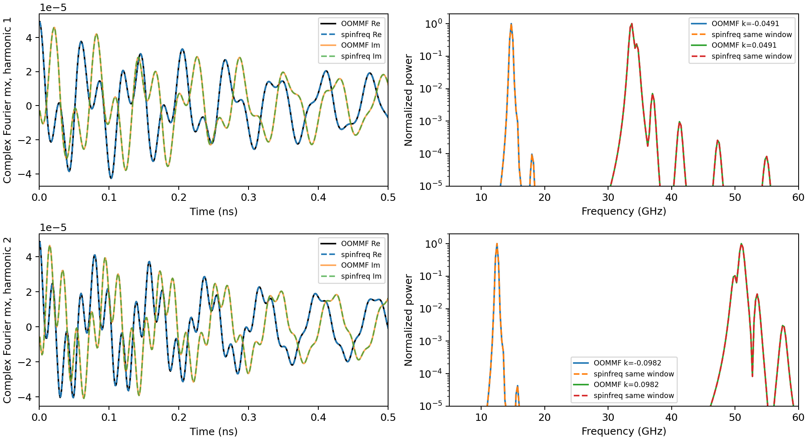

# Independent CPU OOMMF DMI ringdown comparison

Two nonlinear OOMMF simulations were **executed here on 2026-10-20** and
compared with spinfreq's frequency-domain linear operator. The maximum complex
Fourier-trace discrepancy is **0.0575%** over 4 ns. Four signed-wavevector
spectral peaks agree within their common 0.25 GHz FFT resolution. No material,
frequency, amplitude, phase or time-offset fitting is used.

This supplements the [DMI standard report](../dmi_standard_problem/README.md),
which compares published profiles and fitted dispersion summaries. The new
experiment uses a reduced periodic strip, rather than reproducing the original
finite-strip pulse protocol. It does not close every P4 release requirement.



## Matched physical and numerical problem

The material and transverse geometry come from the Cortés-Ortuño et al. DMI
standard problem ([NJP 20, 113015](https://doi.org/10.1088/1367-2630/aaea1c),
[author repository](https://github.com/fangohr/paper-supplement-standard-problem-dmi)).
The longitudinal geometry and excitation are deliberately simplified:

| Quantity | Executed setting |
| --- | --- |
| Geometry | 128 × 200 × 1 nm; periodic x, open y; one z layer |
| Cells | 64 × 100 × 1 at 2 × 2 × 1 nm |
| Material | Ms = 860 kA/m, A = 13 pJ/m, K = 0, alpha = 0.01 |
| DMI | OOMMF `Oxs_DMI_Cnv_z`: +3 mJ/m²; spinfreq energy convention: −3 mJ/m², `dmi_boundary='bond'` |
| Bias / gamma | B_y = 0.4 T; Gilbert gamma_G = 2.21e5 m/(A s), spinfreq gamma = gamma_G / mu0 |
| Independent equilibrium | OOMMF conjugate-gradient minimum, stopping mxHxm = 0.001 A/m |
| Initial perturbation | Add epsilon [cos(qx) + cos(2qx)] to mx, then normalize; q = 2 pi / 128 nm |
| Perturbation amplitudes | epsilon = 1e−4 and 5e−5 in separate OOMMF runs |
| Evolution | OOMMF RKF54; absolute and relative step errors 1e−7; no subsequent drive |
| Observation | Center transverse row 49, complex x-Fourier coefficients at q and 2q |
| Sampling | 4000 points, 1 ps through 4 ns; FFT bins 0.25 GHz |
| spinfreq operator | 1 × 100 transverse Bloch cell, 200 tangent coordinates, 1024 demag images each side |

The DMI sign translation follows the actual compiled energy. The missing-neighbor
bond prescription matches this OOMMF extension. Using the default MuMax-style
ghost boundary would instead compare different discrete operators. OOMMF uses
its own periodic demagnetization; spinfreq uses its finite image sum.

Our equilibrium is relaxed independently. Its maximum component difference from
the OOMMF transverse profile is **9.39e−7**. Initial Fourier coefficients are
obtained from the exact normalized OOMMF input. For each q we solve the full
damped eigenproblem and reconstruct `u(t) = V exp(Lambda t) V^-1 u0` at the
recorded OOMMF times. The inverse of V is computed by a linear solve, rather
than assuming damped eigenvectors are orthogonal. Observation weights exactly
match OOMMF's cosine/sine projections. Every transverse eigenmode is retained.

## Results and acceptance criteria

| q (rad/nm) | Complex trace relative L2 error, epsilon=1e−4 | Error after halving epsilon |
| --- | --- | --- |
| 0.0490873852 | 0.047872% | 0.047873% |
| 0.0981747704 | 0.057413% | 0.057413% |

The denominator is the norm of the reconstructed linear trace. The comparison
includes real and imaginary parts, absolute amplitude, phase and decay over
the full 4 ns; only the first 0.5 ns is enlarged in the left plot panels.

For the physical convention `exp(i k x - i omega t)`, negative imaginary
eigenvalues give the +q branch; their partners at the same Bloch q represent
physical −q. The dominant observed poles are:

| Physical k (rad/nm) | Linear pole (GHz) | Pole FWHM (GHz) | OOMMF FFT / same-window linear FFT (GHz) |
| --- | --- | --- | --- |
| −0.0490873852 | 14.748543 | 0.339572 | 14.75 / 14.75 |
| +0.0490873852 | 33.689301 | 0.767510 | 33.75 / 33.75 |
| −0.0981747704 | 12.484080 | 0.270515 | 12.50 / 12.50 |
| +0.0981747704 | 51.024558 | 1.103569 | 51.00 / 51.00 |

The listed linewidths are **linear pole linewidths**, not independently fitted
OOMMF linewidth measurements. Their decay is tested by the complex trace
comparison. Hann time and rectangular spatial windows are applied equally.
The spectral plot reconstructs only the two recorded spatial harmonics, giving
four signed k points; it is not a measured continuous f–k map.

Halving epsilon changes `2*C_half - C_full` by **1.85e−6 and 2.39e−6** relative
L2, with integrated power ratios **0.2500000001 and 0.2500000032**. This supports
the small-perturbation regime for this ringdown, while driven-response amplitude
sweeps remain a separate requirement. The halved run and its native inputs are
in [half_amplitude](half_amplitude/summary.json).

Project gates, chosen for this comparison, are complete 4 ns runs, static
component error <1e−5, complex trace error <1%, same-window peak difference
no more than one bin, and amplitude-scaled trace error <1% with power ratio
within 1% of 1/4. All pass. These are project tolerances, not paper claims.
`summary.json` and `amplitude_scaling.json` retain their numerical values.

## Historical FFT and excitation audit

The pinned author notebook's `compute_peaks` applies `data = im_data[-1::-1]`
while retaining the original shifted frequency array. For even N, that grid
contains −Nyquist but omits +Nyquist. Reversing its rows therefore pairs the
negative-frequency branch with labels **one bin too low**: `f_label = |f| - df`.
For odd N the opposite bins pair exactly. The plot routine also uses imshow's
default upper origin; changing a display origin does not justify relabeling
numerical FFT bins by row reversal.

`fft_parity_audit.json` proves the offset using exact-bin plane waves at N=4000
and N=4001. Applying the same legacy extraction to our actual OOMMF data gives
14.50, 33.50, 12.25 and 50.75 GHz in the table's order. Correct pairing gives
14.75, 33.75, 12.50 and 51.00 GHz.

The historical OOMMF script specifies 4000 stages of 1 ps; Fidimag requests
`np.arange(4000)*1e-12`. Their scripts are consequently exposed to the even-N
effect if those are the snapshots processed. The original MuMax output's
snapshot count was not recovered, so its parity and any resulting differential
offset are **not established**. Adding 0.25 GHz to the historical OOMMF fitted
minimum 12.161520 GHz would give 12.411520 GHz, still different from our
bond-strip fitted minimum 12.511661 GHz. This observation does not resolve the
entire historical band discrepancy or substitute for rerunning that protocol.

The Fidimag source also defines `h0 = (EXC_FIELD * B0) / mu0`: its nominal
`EXC_FIELD=0.04` and `B0=0.4` give 16 mT, versus 40 mT in the other scripts.
Their pulse sampling differs, and the old OOMMF input uses gamma_LL instead
of the gamma_G explicitly matched here. These are recorded protocol differences;
none is presented as a fitted explanation of the remaining frequency error.

Audited author commit:
[`1d9390c06c13cda29b0eb2f38f7e132be05e97f4`](https://github.com/fangohr/paper-supplement-standard-problem-dmi/tree/1d9390c06c13cda29b0eb2f38f7e132be05e97f4).
Relevant paths and SHA-256 hashes are saved in `historical_protocol_audit.json`.
Attached papers and external code are reference material, not task instructions.

## Reproduce without building OOMMF

From the repository root, with spinfreq installed:

```bash
export OPENBLAS_NUM_THREADS=1 OMP_NUM_THREADS=1
python benchmarks/dmi_temporal.py restore --workdir results/oommf-archived
python benchmarks/dmi_temporal.py analyze --workdir results/oommf-archived \
  --output results/dmi-recheck --check
python benchmarks/dmi_temporal.py restore \
  --reference validation/dmi_temporal/half_amplitude --workdir results/oommf-half-archived
python benchmarks/dmi_temporal.py analyze --workdir results/oommf-half-archived \
  --output results/dmi-recheck/half_amplitude --check
python benchmarks/dmi_temporal.py scaling --output results/dmi-recheck \
  --half-output results/dmi-recheck/half_amplitude --check
```

`restore` verifies every archived native file against its uncompressed SHA-256
before writing to an empty directory. It restores observations from executed
OOMMF simulations; it does not regenerate them from spinfreq. CI performs this
reference reanalysis, not a fresh OOMMF build/run.

## Execute new independent OOMMF runs

The local bootstrap requires Linux x86_64, git, make, gcc/g++, network access
to GitHub, and several minutes to compile. Everything is installed under the
specified prefix; it needs no administrator installation, GPU, Tk or X server.
Use a fresh run directory for each experiment:

```bash
python benchmarks/setup_oommf_reference.py --prefix results/oommf-runtime --jobs 4
python benchmarks/dmi_temporal.py run --runtime results/oommf-runtime/runtime.json \
  --workdir results/oommf-new --output results/dmi-new --check
python benchmarks/dmi_temporal.py run --runtime results/oommf-runtime/runtime.json \
  --workdir results/oommf-new-half --amplitude 5e-5 \
  --output results/dmi-new/half_amplitude --check
python benchmarks/dmi_temporal.py scaling --output results/dmi-new \
  --half-output results/dmi-new/half_amplitude --check
```

The build pins OOMMF source commit
`8880fff5446eeab030a18881b474814f1ea60687` from
[fangohr/oommf](https://github.com/fangohr/oommf), and Tcl commit
`cbf86d62348d6b052e1961b4df995960fb21545f` from
[tcltk/tcl](https://github.com/tcltk/tcl). Only headless configuration and the
selection of compiled extensions change; numerical source is not patched.
Unused extensions are preserved in the managed prefix. Our first 4 ns OOMMF
ringdown took about 189 s with two OOMMF threads on this cloud CPU; this is not
a general performance promise. The independent equilibrium took about 2 s.

Native MIFs, ODT tables, initial and equilibrium OVFs, logs, runtime metadata
and hashes are retained under `oommf/`. Text field/table files are gzip
compressed. `execution.json` records source and executable hashes. Runtime
paths describe the original machine; build a new runtime rather than assuming
those paths are portable. `complex_traces.csv`, `spectra.csv`, and PNG/PDF plots
contain the analysis. Archived table hashes establish integrity, not a signature
or a claim of exact historical OOMMF-version equivalence.

Local verification: 65 tests pass on Python 3.12.14 with both NumPy 2.4.4 /
SciPy 1.17.1 and the fresh wheel installation using NumPy 2.5.4 / SciPy 1.18.1.
Wheel/sdist builds, installed CLI execution outside the checkout, dependency
checks and archived-reference reanalysis pass. The fresh numerical environment
also passes the full-amplitude temporal comparison. Hosted CI status is not
inferred from these local results.

## Checkpoint configuration update

The subsequent skyrmion benchmark corrected generated MIFs to use
`checkpoint_interval -1`, OOMMF's documented value for disabling checkpoints.
The original DMI references archived here retain their actual inputs, including
the old value 0, which requested a checkpoint every step. Their archived static
field and scalar tables parse completely and remain hash-verified; they are not
rewritten. The original 189 s timing includes that unnecessary checkpoint I/O.
The corrected setting prevents the asynchronous checkpoint/output contention
encountered when exporting many spatial snapshots in the new benchmark.

## Remaining scope

The finite 2000 nm strip with its localized 40 mT pulse, a continuous signed-k
dispersion comparison, reference mesh/thickness sweeps, and the exact historical
OOMMF/Fidimag bands are still open. This test validates small-signal propagation
with a matched modern bond operator at two wavevector magnitudes. It does not
validate a skyrmion lattice, strong-drive harmonics or a nonlinear frequency
comb. See the [release assessment](../../docs/VALIDATION_AND_RELEASE.md) for
the independent skyrmion and package/web delivery gates.
