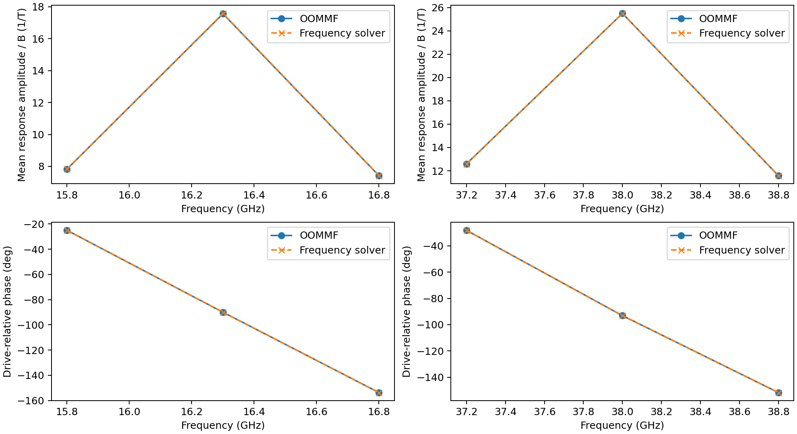
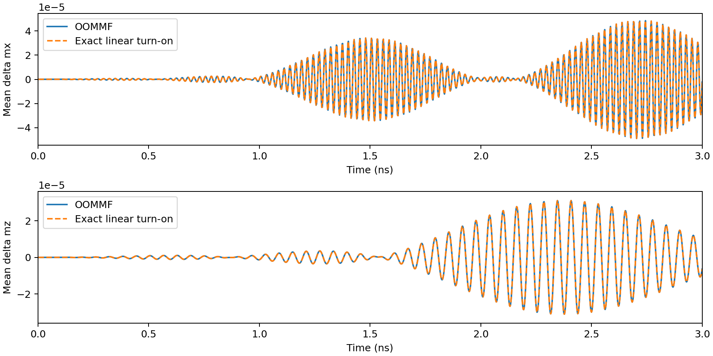

# Independent driven amplitude, phase and linear-regime validation

Executed nonlinear CPU OOMMF simulations test six weak sinusoidal tones near
two skyrmion resonances. The frequency solver predicts their complex mean
response within **0.14%**, with drive-relative phase differences below
**0.008 degrees**. The complete smooth turn-on trace agrees within **0.0048%**.
Halving the applied field halves the response and quarters both squared
response and inferred absorbed power.



## Physical problem and excitation

This is the same **40 × 40 × 1 nm square, 20 × 20 × 1 cells, Bz = 0** bond-DMI
problem as the [independent skyrmion reference](../skyrmion_temporal/README.md).
Ms = 580 kA/m, A = 15 pJ/m, K = 0.6 MJ/m³, D = +3 mJ/m² in our convention,
alpha = 0.01 and gamma = 1.7595e11 rad/(s T) are unchanged. OOMMF uses the
corresponding modern Cnv D = −3 mJ/m². Its independently relaxed equilibrium
is copied byte-for-byte into each drive run and identified by hash. It is
not initialized with a response predicted by spinfreq.

The drive is a simultaneous sum of six prescribed tones:

| Axis | Frequencies (GHz) | Region sampled |
| --- | --- | --- |
| z | 15.8, 16.3, 16.8 | Breathing resonance |
| x | 37.2, 38.0, 38.8 | Upper gyration resonance |

Each tone has peak field **1 microtesla** in the full run and **0.5 microtesla**
in the independent half run. These amplitudes are per tone, not the maximum
of the summed field. All start with zero carrier phase and share the envelope
`r(t)=(1-cos(pi*t/2 ns))/2` until 2 ns, then 1. OOMMF's `ScriptUZeeman` is
given both the field and its exact time derivative, in A/m and A/(m s).
All three mean magnetization components are sampled every 2 ps through 8 ns.
The drive frequencies were selected from the previous linear study; no
material constants or measured frequencies are fitted to improve agreement.

The 2 nm grid isolates the forcing implementation on an existing matched
discrete problem. It is not continuum-qualified. The [separate fine-grid
ringdown comparison](../skyrmion_fine/README.md) supplies spatial dynamics at
1 nm. No spatial forced-response snapshots or fine-grid driven sweep are
measured in this experiment.

## Frequency-domain prediction and measurement

`ModalResponse` prepares the full 800-coordinate damped Jacobian and its
complete right eigenbasis. Each stationary phasor solves
`(i*omega*I-J) u = F*b`, with true shifted-system residual checks. The basis
inverse uses LU solves; damped modes are not assumed orthogonal.

Exact modal convolution with the raised-cosine envelope predicts the full
startup trace. It includes the transient from initially zero perturbation.
No temporal integration of our nonlinear LLG is used to generate a reference.
OOMMF independently integrates its nonlinear equations with the actual drive.

Known-frequency least squares extracts the OOMMF phasors over **4–8 ns**, with
a constant offset and cosine/sine terms for all six tones simultaneously.
The phasor is `cosine_coefficient - i*sine_coefficient`. This measures amplitude
and phase; the prediction is not rescaled, phase-aligned or time-shifted.
The complex-vector error includes all xyz components, rather than just the
driven axis. Demodulation conditioning and residuals are saved.

The stationary phasor and finite-time measurement differ slightly because
the startup transient remains. Applying the same measurement to the exact
linear transient predicts a bias up to **0.139%** in this window. It accounts
for most of the measured discrepancy and is reported for each tone. The full
turn-on comparison separately tests the transient prediction.



## Amplitude scaling, power and numerical control

The full and half time traces differ by **0.00232%** after multiplying the
half trace by two. Tone-by-tone complex scaling errors are below **5.83e−7**
relative. Squared-response ratios range from **0.24999982 to 0.25000027**.
Absorbed-power ratios range from **0.24999998 to 0.25000018**.

Per-tone absorbed power is inferred from the independent measured phasor:
`P = -Ms*V*omega*B*Im(delta m_axis)/2`. It is positive at all six frequencies,
and the frequency prediction uses the same formula and physical units. These
are inferred drive-work powers, not separately recorded OOMMF heat outputs.
Both resonance-center samples exceed their corresponding side samples; three
points per resonance do not certify a fitted linewidth or exact peak location.

OOMMF RKF54 uses **absolute_step_error = 1e−7 degrees**, relative step error
disabled (`-1`), and the pinned evolver's default error-rate control of
1 degree/ns. Checkpointing is disabled (`-1`). An initial exploratory run
with relative_step_error = 1e−7 developed tiny steps as the ramp began near
zero torque; it was stopped and is not included as an accepted reference.
This numerical-control change does not change the magnetic model or drive.

A third full-amplitude run tightens the angular tolerance five-fold to
**2e−8 degrees**. [tolerance_check.json](tolerance_check.json) records the
differences in all six complex responses and the complete trace, with a
predeclared **0.5%** maximum-change criterion. Its native reference is archived
separately under `tight/`.

That angular-tolerance change barely changes the step count, so a fourth
full-amplitude run additionally caps the internal step at **50 fs**. Its
[step-refinement report](step_refinement/tolerance_check.json) requires the
actual iteration count to increase by at least 50%, as well as the same 0.5%
complex-response and trace-change criteria. This distinguishes demonstrated
step refinement from insensitivity to an inactive error control. The raw
step-capped reference is under `step_refinement/tight/`.

The measured count increases from **62,761 to 164,001 steps**. The largest
complex-response change is **9.66e−10 relative**, and the full-trace change is
**1.39e−9 relative**. The angular-only rerun used 63,109 steps, illustrating
why the explicit step-cap check adds stronger evidence. Both numerical-control
checks pass their unchanged 0.5% criteria.

Other project gates are complex response errors <2%, driven-component phase
errors <1 degree, full/half turn-on trace errors <2%, complex amplitude-halving
errors <1%, power ratios within 1% of 1/4, positive absorption and center samples
stronger than their side samples. These are project criteria, not tolerances
claimed by a paper. The main comparison and numerical-control checks have
separate JSON reports and separate `--check` commands.

## Reanalyze without OOMMF

With spinfreq installed, run from the source checkout or unpacked sdist:

```bash
export OPENBLAS_NUM_THREADS=1 OMP_NUM_THREADS=1
for case_name in full half tight; do
  python benchmarks/driven_response.py restore \
    --reference validation/driven_response/$case_name \
    --workdir results/driven-$case_name
done
python benchmarks/driven_response.py restore \
  --reference validation/driven_response/step_refinement/tight --workdir results/driven-step
python benchmarks/driven_response.py analyze --workdir results/driven-full \
  --half-workdir results/driven-half --output results/driven-recheck --check
python benchmarks/driven_response.py tolerance --workdir results/driven-full \
  --tight-workdir results/driven-tight --output results/driven-recheck --check
python benchmarks/driven_response.py tolerance --workdir results/driven-full \
  --tight-workdir results/driven-step --output results/driven-recheck/step_refinement --check
```

Restoration checks archive and native file hashes before writing to an empty
directory. CI performs both checks using the archived independent data.
It does not execute OOMMF.

## Execute new references

First restore the original OOMMF equilibrium, or independently regenerate its
zero-field case using the [skyrmion workflow](../skyrmion_temporal/README.md).
Build the pinned runtime using the [CPU bootstrap](../dmi_temporal/README.md).
Run external jobs sequentially because OOMMF's archive service is shared:

```bash
python benchmarks/skyrmion_temporal.py restore \
  --reference validation/skyrmion_temporal/field_0mT --workdir results/drive-equilibrium
python benchmarks/driven_response.py run --equilibrium-directory results/drive-equilibrium \
  --runtime results/oommf-runtime/runtime.json --workdir results/drive-new-full
python benchmarks/driven_response.py run --equilibrium-directory results/drive-equilibrium \
  --runtime results/oommf-runtime/runtime.json --workdir results/drive-new-half --amplitude-uT .5
python benchmarks/driven_response.py run --equilibrium-directory results/drive-equilibrium \
  --runtime results/oommf-runtime/runtime.json --workdir results/drive-new-tight --absolute-step-error-deg 2e-8
python benchmarks/driven_response.py run --equilibrium-directory results/drive-equilibrium \
  --runtime results/oommf-runtime/runtime.json --workdir results/drive-new-step \
  --absolute-step-error-deg 2e-8 --max-step-ps .05
python benchmarks/driven_response.py analyze --workdir results/drive-new-full \
  --half-workdir results/drive-new-half --output results/drive-new --check
python benchmarks/driven_response.py tolerance --workdir results/drive-new-full \
  --tight-workdir results/drive-new-tight --output results/drive-new --check
python benchmarks/driven_response.py tolerance --workdir results/drive-new-full \
  --tight-workdir results/drive-new-step --output results/drive-new/step_refinement --check
```

`--amplitude-uT` is peak applied field per tone, not magnetization perturbation.
`--frequencies-GHz` accepts six frequencies, with the first three driving z
and the last three x. Choose a physically suitable grid if using another bias
or cell size. The experiment qualifies only the settings executed here.

Each native archive contains the actual drive MIF, input equilibrium, original
equilibrium configuration, scalar table, logs, numerical settings and pinned
runtime/source hashes. CSVs provide full/half time traces and complex vector
responses. Figures are PNG and vector PDF. Small-signal linearity at these
settings does not establish nonlinear comb generation, finite-temperature
physics, a thickness envelope or general solver release readiness.
