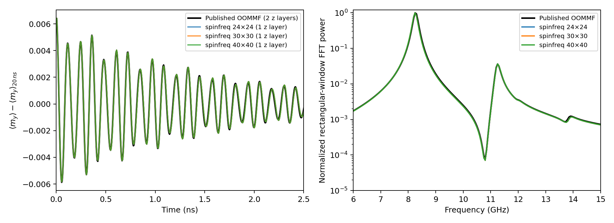
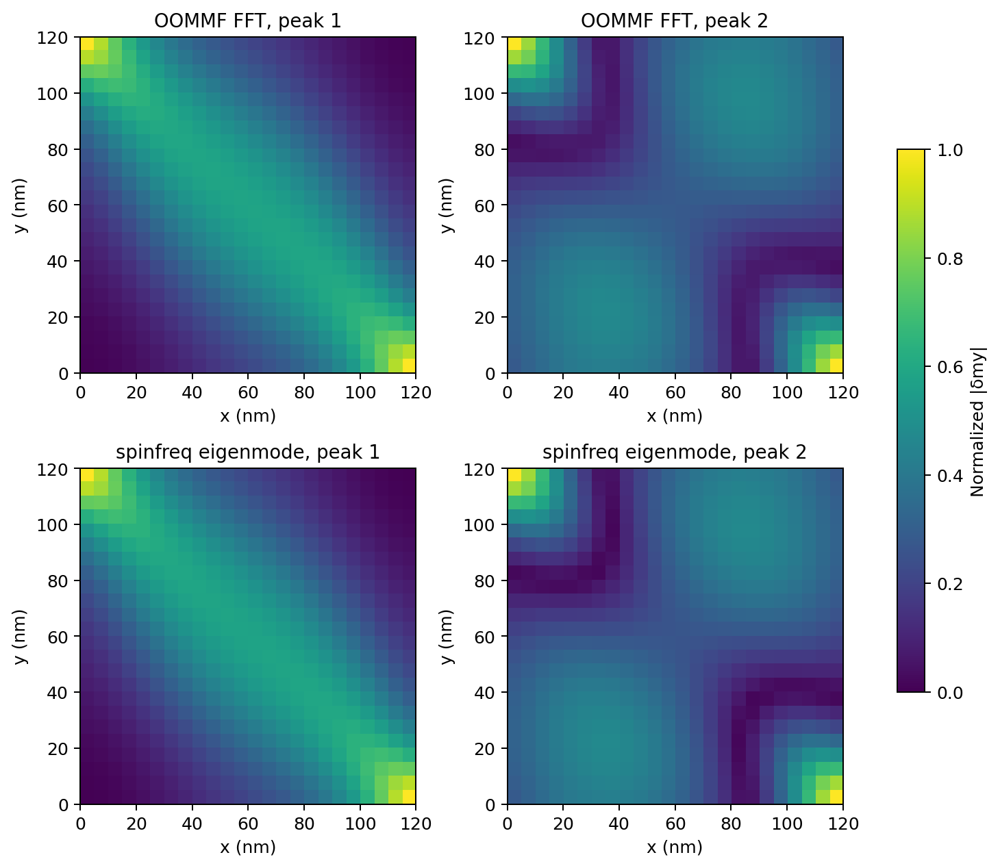

# FMR standard problem: published OOMMF versus spinfreq

This benchmark compares a linear frequency-domain calculation against the
**authors' actual OOMMF reference data**, without using our nonlinear integrator
as a reference. It supplies an independent validation family beyond Liu.

Reference: A. Baker et al., *Proposal of a micromagnetic standard problem for
ferromagnetic resonance simulations*, Journal of Magnetism and Magnetic
Materials **421**, 428–439 (2017),
[DOI:10.1016/j.jmmm.2016.08.009](https://doi.org/10.1016/j.jmmm.2016.08.009).
[Author repository](https://github.com/fangohr/micromagnetic-standard-problem-ferromagnetic-resonance),
[archived dataset DOI](https://doi.org/10.5281/zenodo.59714).

## Reproduce

From an installed source checkout:

```bash
OPENBLAS_NUM_THREADS=1 OMP_NUM_THREADS=1 \
  python benchmarks/fmr_standard_problem.py --fetch-reference --check
```

This retrieves `dynamic_txyz.txt` and `mys.npy` (~18 MiB total) into
`results/reference/baker2017/oommf/`, verifies SHA-256 checksums, and runs
24×24, 30×30 and 40×40 meshes. The first use needs network access; later uses
can reuse these files. The authors' reference commit is pinned to
`c7051885417864508bfe6bb3511adad361395b87`, not a changing branch.

Alternatively clone the author repository and supply its data directly:

```bash
OPENBLAS_NUM_THREADS=1 OMP_NUM_THREADS=1 \
  python benchmarks/fmr_standard_problem.py \
  --reference-directory /path/to/author-repository/micromagnetic_simulation_data/reference_data/oommf
```

Use `--cells 24` for a shorter diagnostic without mesh-convergence certification,
or `--output results/fmr_check` to avoid replacing tracked results.
`--check` makes a failed proposed acceptance gate return a nonzero exit code;
the package CI runs all three meshes with this flag. Omit it for exploratory
single-mesh runs, which cannot pass the mesh-convergence gate.
An absent reference without `--fetch-reference`, or a checksum mismatch, fails
explicitly. Full upstream spatial arrays are not vendored here; CSVs and figures
are derived comparisons with attribution to the authors above.

## Model and comparison method

- Finite 120×120×10 nm permalloy square; `Ms=800 kA/m`, `A=13 pJ/m`, no DMI
  or anisotropy; physical damping `alpha=0.008`.
- The input's `gamma_G=2.210173e5 m/(A s)` is converted to our tesla convention
  as `gamma=gamma_G/mu0`.
- A constant `H=80 kA/m` changes direction from
  `(0.81345856316858023, 0.58162287266553481, 0)` to
  `(0.81923192051904048, 0.57346234436332832, 0)`.
- Both equilibria are relaxed/refined to a maximum transverse field below
  `1e-9 T`. The old state is projected into the new equilibrium's tangent plane.
- The full damped Jacobian is diagonalized and `exp(J t) u0` is reconstructed
  using all modes. The inverse right-mode basis supplies modal coefficients;
  a Hermitian transpose would be incorrect for a general nonnormal matrix.
- The time samples and rectangular FFT window match the published data:
  4000 samples, 5 ps to 20 ns, 5 ps spacing. This is a **linear ringdown
  reconstructed from frequency modes**, not a newly integrated time trajectory.
- The two strongest published mean-my FFT peaks below 20 GHz select the visible
  comparison modes. Other eigenmodes exist between them; they are not claimed
  absent because a uniform excitation has weak or zero overlap.

The published OOMMF mesh is **5×5×5 nm, two z layers**. Our mesh is
**(5, 4 or 3)×(5, 4 or 3)×10 nm, one uniform z layer**. The authors' supplied
spatial arrays average their two z layers. The comparison therefore measures
our thin-film approximation, not an identical three-dimensional discretization.

## Results

All three equilibria are stable within the full dense spectrum calculated here.
The largest real eigenvalue is approximately `-6.08e8 s^-1`. The finest static
residual is `1.33e-11 T`; the maximum initial tangent displacement is 0.0122,
consistent with the small-angle comparison.

| Lateral spacing | Visible eigenmode 1 (GHz) | Visible eigenmode 2 (GHz) | Complex y-MAC 1 | Complex y-MAC 2 |
| --- | ---: | ---: | ---: | ---: |
| 5 nm | 8.253057 | 11.234307 | 0.999906 | 0.980170 |
| 4 nm | 8.252946 | 11.234217 | 0.999901 | 0.980273 |
| 3 nm | 8.252636 | 11.234064 | 0.999879 | 0.980285 |

The OOMMF raw FFT peaks are **8.25 and 11.25 GHz**, with **0.05 GHz** bin
spacing. The finest raw-bin discrepancies are 0.032% and 0.142%. The two finest
lateral meshes differ by only 0.00375% and 0.00136% for these modes. Refining our
lateral mesh does not remove the reference's finite mesh or our missing z
variation.

For complex fields `a,b`, mode overlap is
`MAC = |a†b|² / [(a†a)(b†b)]`. We compare the eigenmode's y component with
the published y-component FFT map at its peak, interpolating our finer meshes
onto reference cell centers. There is no reflection, rotation or translation
fit. MAC removes arbitrary global phase and normalization. It does not validate
the unexamined x/z components or higher eigenmodes.





### Sub-bin poles and linewidths

The independent OOMMF mean trace is fitted to an offset plus three damped
sinusoids. The third, weaker pole near 13.9 GHz is a nuisance contribution;
only the first two are validation targets. Frequency search bounds are ±0.35 GHz
about the raw FFT peaks, and decay-rate bounds are 0.01–3 per ns. Linear offset,
sine and cosine coefficients are eliminated by least squares at each nonlinear
step. No spinfreq material or geometry parameter is fitted.

For an isolated pole `lambda=-eta+i*2*pi*f`, the susceptibility-power Lorentzian
has `FWHM=eta/pi` in Hz. This pole linewidth must not be confused with arbitrary
finite-window widths or with an absorption envelope containing several modes.

| Quantity | OOMMF fitted trace, 0–8 ns | spinfreq, 3 nm | Relative discrepancy |
| --- | ---: | ---: | ---: |
| Mode 1 frequency (GHz) | 8.266841 | 8.252636 | 0.172% |
| Mode 2 frequency (GHz) | 11.227706 | 11.234064 | 0.057% |
| Mode 1 pole FWHM (GHz) | 0.205468 | 0.204863 | 0.295% |
| Mode 2 pole FWHM (GHz) | 0.220196 | 0.219324 | 0.396% |

Repeating the reference fit after discarding 0.1, 0.3 and 0.5 ns changes the
first linewidth by at most **0.070%** and the second by **1.33%** relative to
the baseline fit. The fit residual RMS is below **0.39%** of the signal standard
deviation across these windows. This sensitivity analysis is descriptive;
it is not a statistical confidence interval. Reference fitted frequency and
linewidth errors differ from raw-bin errors and are reported separately.

The proposed project gates (frequency <1%, final lateral refinement <0.5%,
y-MAC >0.95, fitted linewidth error/window sensitivity <5% with fit residual
<1%) all pass for these two visible modes. These are our acceptance thresholds,
not tolerances prescribed by the paper.

## Output and remaining limits

- `summary.json`: input provenance/checksums, physical parameters, residuals,
  mesh comparisons, pole-fit windows, gate results and measured wall times.
- `ringdown.csv`, `spectra.csv`: plotted numerical data.
- `comparison.png/.pdf`, `mode_amplitudes.png/.pdf`: raster/vector figures.

On this cloud CPU with single BLAS threads, complete eigendecomposition and
ringdown reconstruction took a few seconds for the 24×24/30×30 meshes and tens
of seconds for 40×40; consult `summary.json` for the measured run. Equilibrium
and assembly took additional time. A single
40×40 real Jacobian occupies 78.125 MiB; actual peak memory is larger. Timings
are shared-host observations, not a web-service performance guarantee.

This result does not validate z-dependent modes, all dark/higher modes,
arbitrary damping, nonlinear response, independent driven complex susceptibility
or the entire reference paper. The upstream Nmag data are available but have
not been included in this comparison. The remaining broader release gates are
listed in [Validation and release](../../docs/science/VALIDATION_AND_RELEASE.md).
