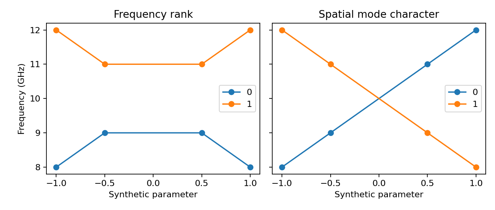
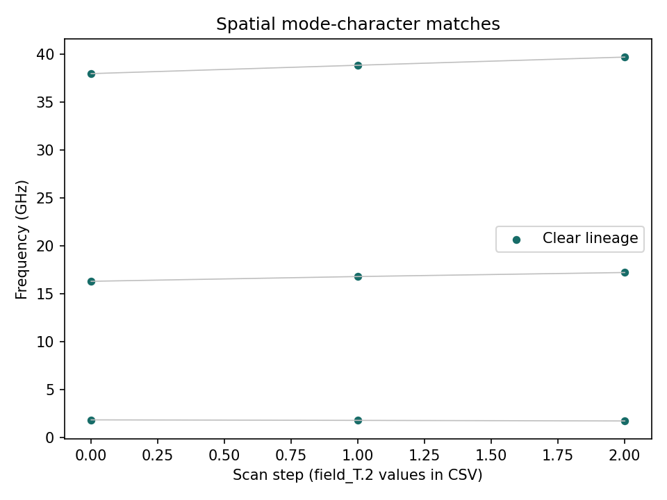

# Mode-character tracking checks

This report qualifies the assignment/uncertainty workflow, not new micromagnetic
physics or unique mode identities at degeneracy.

| Check | Result |
| --- | --- |
| Synthetic independent-mode crossing with arbitrary phase/scale | Correct character labels through frequency-rank reversal; zero frequency error |
| Rotated basis of a degenerate two-mode subspace | Both assignments flagged ambiguous |
| Three lowest modes of the existing 0 → 25 → 50 mT skyrmion study | Nine rows; minimum adjacent MAC 0.9949108; no provisional lineages under default thresholds |

The synthetic crossing illustrates why nearest-frequency ordering is inadequate.
It does not represent a new executed device simulation. The real scan uses the
existing coarse 2 nm confined-skyrmion model; its independent temporal comparisons
and continuum-refinement limits remain in the
[research-workflow report](../research_workflows/README.md) and
[fine-grid qualification](../skyrmion_fine/README.md).





Data: [branches](branches.csv), [crossing](crossing.csv),
[tracking provenance](tracking.json), [qualification](qualification.json).
Vector plots: [crossing](crossing.pdf), [branches](branches.pdf).
The reports preserve original study fingerprints and input artifact hashes,
plus the tracking and benchmark code hashes.

## Reproduce

From a source checkout, using fresh output directories:

```bash
python -m pip install -e .
OPENBLAS_NUM_THREADS=1 OMP_NUM_THREADS=1 python benchmarks/research_continuation.py --check --output results/skyrmion-reference
python benchmarks/mode_tracking.py --study results/skyrmion-reference/study --output results/mode-tracking --check
```

CI runs the same comparison after its existing skyrmion workflow. Tests also
cover phase/scale invariance, unequal counts, persistent ambiguity after a
degeneracy, failure gaps, tampered-artifact rejection, locks and overwrite refusal.
See [the usage guide](../../docs/guides/MODE_TRACKING.md) before treating a branch
ID as a physical label; parameter spacing, symmetries and the chosen mode window
still require research judgement.
