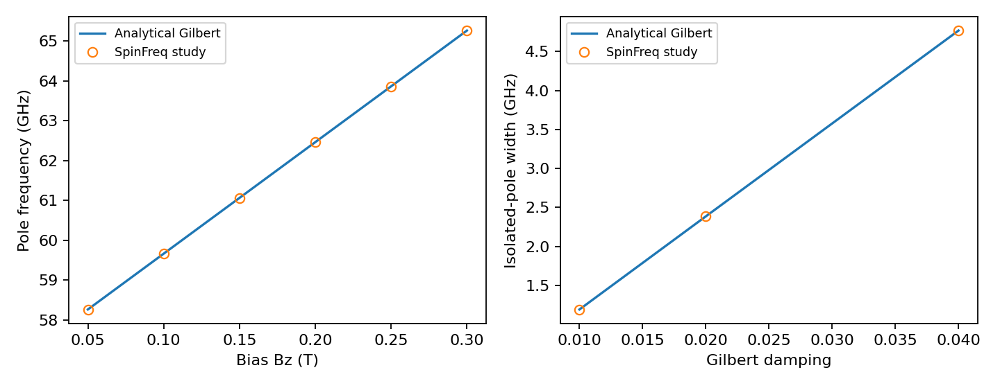
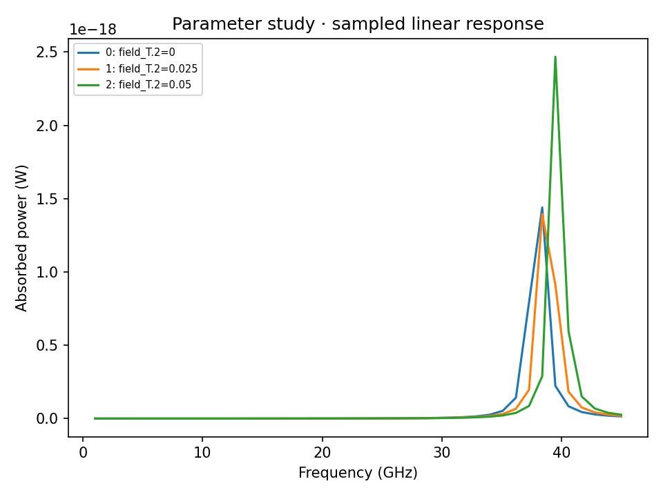

# Local research workflow qualification

These checks exercise parameter studies and equilibrium continuation using the
existing physical model. They do not qualify additional device geometries,
current torques or a general parameter envelope.

## Analytical field and damping studies

Nine single-cell periodic-film cases cover six bias fields (50–300 mT) with
equilibrium continuation and three independently seeded damping values. An
independent closed two-coordinate Gilbert susceptibility is compared with full
complex response, power, eigenfrequency and isolated-pole linewidth.

| Observable | Maximum relative error |
| --- | --- |
| Pole frequency | 2.23e-16 |
| Pole linewidth | 2.23e-16 |
| Full complex response | 8.91e-15 |
| Absorbed power | 8.15e-15 |

All gates pass at 1e-10. See [report](fmr_report.json),
[CSV](analytic_comparison.csv) and [vector figure](analytic_comparison.pdf).



## Confined-skyrmion continuation

Three cases follow 0 → 25 → 50 mT on the matched 40 × 40 × 1 nm confined film,
with 2 nm lateral cells, bond DMI and positive Gilbert damping. All converge,
pass the stability/response gates and preserve byte-identical previous
equilibria as their next starting states. Endpoint comparisons use the
**existing independently executed OOMMF** fitted poles, not a new temporal run.

The six endpoint frequencies differ by at most **0.0181%** (gate: 0.03%).
The intermediate 25 mT case is numerical continuation; it has no new independent
OOMMF comparison here. See [report](skyrmion_report.json),
[endpoint CSV](skyrmion_endpoints.csv), [diagnostics](skyrmion_cases.csv)
and [poles](skyrmion_poles.csv). Reference data attribution remains in the
[original two-field report](../skyrmion_temporal/README.md).



The coarse model is not continuum converged; see the separate
[fine-grid study](../skyrmion_fine/README.md). Frequency ranks do not establish
mode identity across crossings. Discretized topological charge need not be an
integer in a finite film. Continuation does not prove a ground state.

## Reproduce

Use new output directories from a source checkout:

```bash
python -m pip install -e .
OPENBLAS_NUM_THREADS=1 OMP_NUM_THREADS=1 python benchmarks/research_studies.py --check
OPENBLAS_NUM_THREADS=1 OMP_NUM_THREADS=1 python benchmarks/research_continuation.py --check
```

These are also CI checks. Commands generate full per-case initial states,
equilibria, complex modes, response and hashes. Files committed here are curated
reports, numerical tables and PNG/PDF figures. Reports include configurations
and numerical source/dependency fingerprints. Tests separately cover invalid
input, changed-code and modified-artifact refusal, interrupted retry, failure
stopping, independent cases, state import and CLI exit status. See the
[research guide](../../docs/guides/RESEARCH.md) for usage and interpretation.
