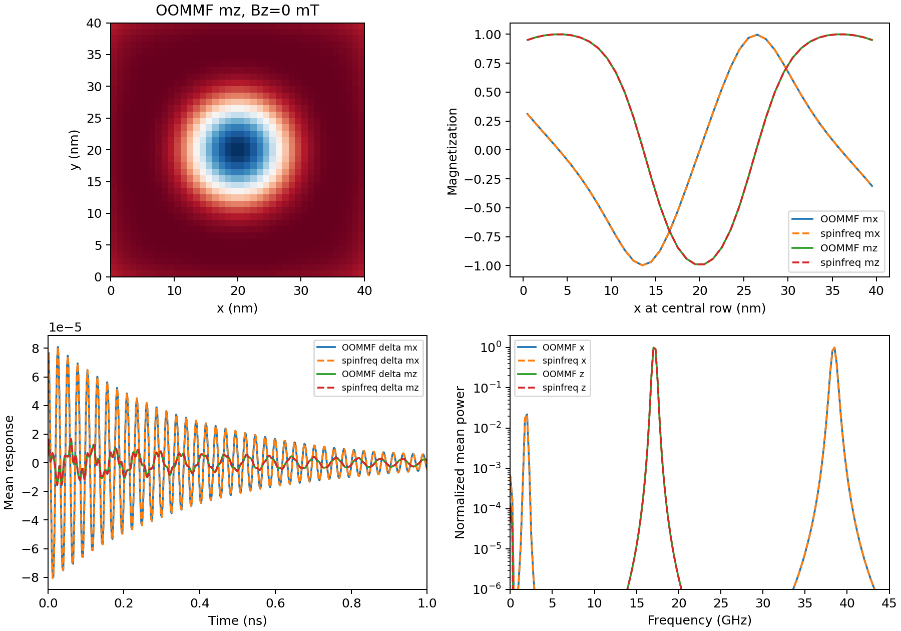
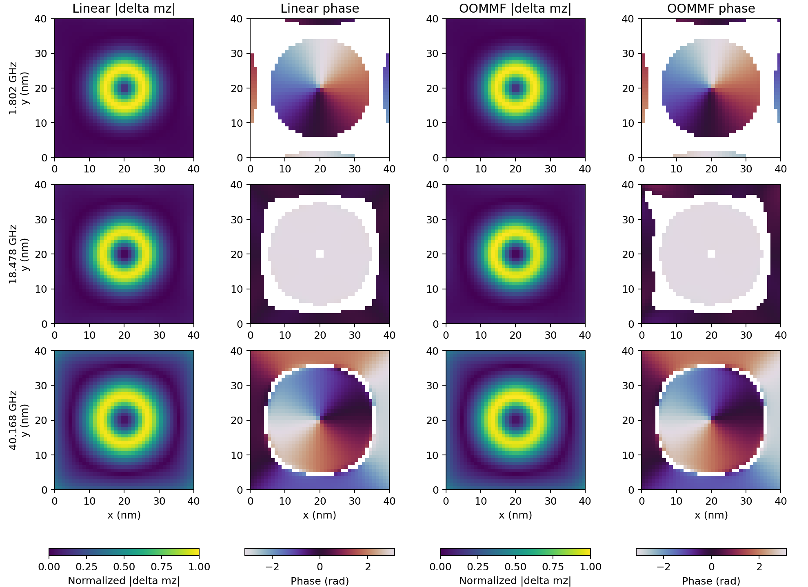

# Fine-grid independent skyrmion dynamics

Two **executed CPU OOMMF** runs now compare full spatial dynamics at 1 nm
lateral resolution, at Bz = 0 and 50 mT. Together with the retained 1 → 0.8 nm
linear refinement, they pass the project's two-field fine-mesh noncollinear
evidence gate for this specified model. This qualification is recorded in
[qualification.json](qualification.json).

The physical problem is the finite 40 × 40 × 1 nm square and matched bond-DMI
operator from the [earlier 2 nm report](../skyrmion_temporal/README.md).
Ms = 580 kA/m, A = 15 pJ/m, K = 0.6 MJ/m³, interfacial D = +3 mJ/m² in our
convention (−3 in the compiled OOMMF Cnv extension), alpha = 0.01, and
gamma = 1.7595e11 rad/(s T) are unchanged. Both codes independently relax the
same analytic seed; no material parameters are fitted.

Each new reference uses **40 × 40 × 1 cells**, an initial normalized
magnetization perturbation of 1e−4 × (1,0,1), **4 ns** of free ringdown,
2000 mean-vector samples at 2 ps, and **400 full vector snapshots** at 10 ps.
The first snapshot is at 2 ps, then every fifth stage; the last is at 3.992 ns.
The 4 ns duration meets the previously declared minimum. The earlier coarse
references retain their original 8 ns duration and are not rewritten.



| Quantity | 0 mT | 50 mT |
| --- | --- | --- |
| Maximum static component difference | 8.88e−12 | 1.30e−11 |
| Full spatial trace relative L2 error | 0.009587% | 0.008118% |
| Mean-vector trace relative L2 error | 0.005579% | 0.005109% |
| Largest fitted frequency difference | 0.007304% | 0.005192% |
| Smallest complex-vector mode MAC | 0.997347 | 0.997062 |
| Open-domain Q from OOMMF | −0.908393 | −0.904563 |

| Bz (mT) | Mode | Linear frequency (GHz) | Independent OOMMF fit (GHz) |
| --- | --- | --- | --- |
| 0 | 1 | 1.895865 | 1.896004 |
| 0 | 2 | 17.113072 | 17.112295 |
| 0 | 3 | 38.415952 | 38.415941 |
| 50 | 1 | 1.801709 | 1.801789 |
| 50 | 2 | 18.478206 | 18.479165 |
| 50 | 3 | 40.167536 | 40.167612 |

The full **3200-coordinate damped Jacobian** reconstructs every observed cell
and component through the complete eigenbasis. The independent OOMMF-only
three-pole fits, start-time sensitivity and complex spatial-mode extraction
use the same method and criteria as the earlier report. The full trace includes
all modes; the three-mode fit is an approximation used to extract the listed
visible modes. Fit residuals, linewidth diagnostics and absolute eigen residuals
are retained in each case summary.



## Qualification and its limits

The retained [1 → 0.8 nm mesh study](../skyrmion_temporal/mesh_fine/summary.json)
changes these three frequencies by at most **0.490% at 0 mT** and **0.648% at
50 mT**, passing the unchanged 1% criterion. The qualification command verifies
the material, geometry, boundary, bias, independent-case gates and linear poles
against that finest pair. A coarse 2 nm dynamical case cannot satisfy this
fine-grid gate merely because a separate fine-grid study exists.

The joint report requires both independent cases to pass, frequencies within
2%, complex-vector MAC >0.95, full spatial trace error <2%, stable/converged
equilibria and finest-pair mesh changes <1%. All pass for this model. The
standalone case summaries retain their generic release/mesh flags: they do not
themselves load a second field case or a mesh study. The combined evidence is
evaluated by `qualification.json`.

This is not a continuum error bound or a qualification of arbitrary thickness,
material, geometry, damping or boundary settings. All comparisons still have
one uniform z layer. The original Liu MuMax ghost boundary and collective-band
disagreements are distinct application questions. The joint report explicitly
keeps general thickness qualification and full simulator release readiness
false.

## Reanalyze archived native data

From the checkout or unpacked source distribution with spinfreq installed:

```bash
export OPENBLAS_NUM_THREADS=1 OMP_NUM_THREADS=1
for case_name in field_0mT field_50mT; do
  python benchmarks/skyrmion_temporal.py restore \
    --reference validation/skyrmion_fine/$case_name --workdir results/fine-$case_name
  python benchmarks/skyrmion_temporal.py analyze --workdir results/fine-$case_name \
    --output results/fine-recheck/$case_name --check
done
python benchmarks/skyrmion_temporal.py qualify --reference results/fine-recheck \
  --output results/fine-recheck --check
```

The default `--mesh-reference` is the committed finest-pair JSON. Archives
contain the actual MIFs, seed, initial state, independent equilibrium, scalar
tables, every spatial snapshot, logs and runtime/source hashes. Restoration
verifies all native hashes before writing. CI reanalyzes these data and repeats
the joint qualification; it does not execute OOMMF.

To generate new references with the existing pinned CPU runtime, execute
**sequentially** in fresh run directories:

```bash
python benchmarks/skyrmion_temporal.py run --runtime results/oommf-runtime/runtime.json \
  --cells 40 --duration-ns 4 --field-mT 0 --workdir results/fine-new-0 \
  --output results/fine-new/field_0mT --check
python benchmarks/skyrmion_temporal.py run --runtime results/oommf-runtime/runtime.json \
  --cells 40 --duration-ns 4 --field-mT 50 --workdir results/fine-new-50 \
  --output results/fine-new/field_50mT --check
python benchmarks/skyrmion_temporal.py qualify --reference results/fine-new \
  --output results/fine-new --check
```

Runtime construction is documented in the [CPU OOMMF report](../dmi_temporal/README.md).
These reference computations are substantially more expensive than the 2 nm
cases because the finer exchange discretization restricts explicit temporal
steps. The frequency solver's dense all-mode preparation also grows with mesh
size; this test does not establish large-array scalability.
