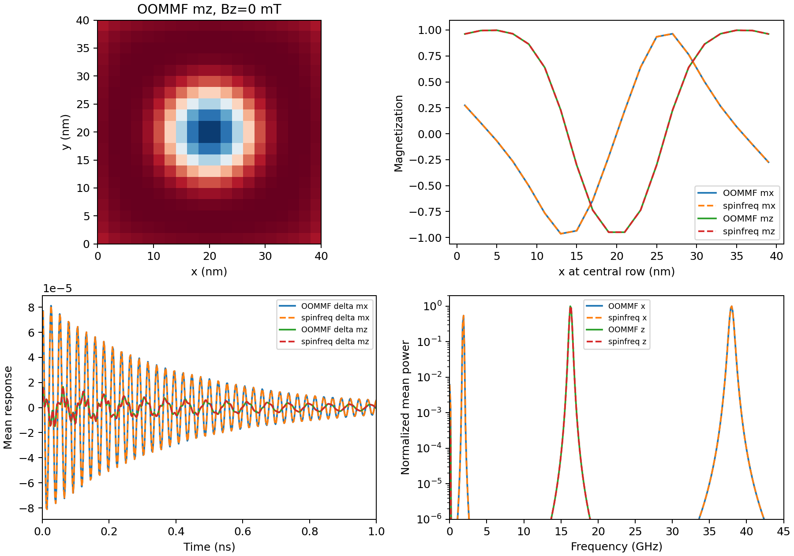
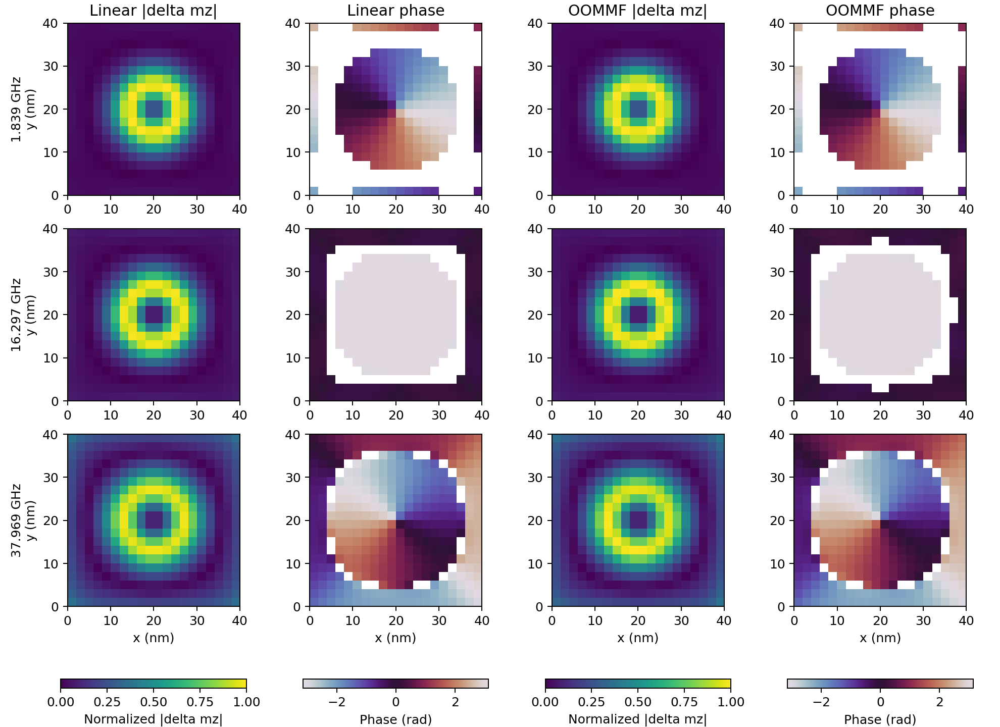
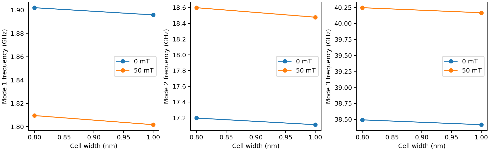

# Independent skyrmion validation at two fields

Two **executed CPU OOMMF** simulations test noncollinear thin-film dynamics at
Bz = 0 and 50 mT. Each has 8 ns of scalar observations and 800 full spatial
magnetization snapshots. Frequency-domain reconstruction agrees with the full
spatial motion within **0.0086%**. All six complex mode overlaps exceed **0.998**;
independently fitted frequencies agree within **0.019%**.

This addresses the noncollinear-dynamics validation category independently of
the earlier uniform-film FMR and DMI propagation checks. It is an implementation
comparison on a matched discrete problem. Mesh qualification and the original
paper's boundary prescription are separate questions.



## Physical problem and independent reference

The square-film material is based on Liu et al., PRB 110, 184413 (2024),
[DOI](https://doi.org/10.1103/PhysRevB.110.184413). The reference run here uses
OOMMF and its **bond DMI boundary**, an explicit variation of that paper's
MuMax3 natural ghost boundary. No reported Liu frequency is used to fit or
accept the new calculation. This complements our
[published-frequency comparison](../liu2024/README.md), rather than replacing it.

| Setting | Value |
| --- | --- |
| Geometry | Finite 40 × 40 × 1 nm square; no periodic axes; one z layer |
| External reference mesh | 20 × 20 × 1, cells 2 × 2 × 1 nm |
| Material | Ms = 580 kA/m, A = 15 pJ/m, K = 0.6 MJ/m³, alpha = 0.01 |
| Interfacial DMI | spinfreq D = +3 mJ/m²; modern OOMMF `Oxs_DMI_Cnv_z` D = −3 mJ/m² |
| Gyromagnetic ratio | spinfreq gamma = 1.7595e11 rad/(s T); OOMMF gamma_G = mu0 × gamma |
| Applied field | Separate runs at Bz = 0 and +0.05 T |
| Equilibrium | Analytic radial seed, independently relaxed by each code |
| OOMMF minimum | Conjugate-gradient evolver, stopping mxHxm = 1e−4 A/m |
| Initial perturbation | Add 1e−4 × (1,0,1) to the OOMMF equilibrium, then normalize each cell |
| Evolution | Nonlinear OOMMF RKF54, absolute and relative step errors 1e−7; free ringdown |
| Scalar output | Every 2 ps, from 2 ps through 8 ns: 4000 observations |
| Spatial output | Every fifth stage: 800 binary-8 OVF2 Spin fields, from 2 ps through 7.992 ns |
| Frequency reconstruction | Full 800-coordinate tangent Jacobian and all its eigenmodes |

The OOMMF DMI sign is translated from the compiled energy convention. Demag,
exchange, easy-z anisotropy, Zeeman and bond DMI are all included in both codes.
This benchmark uses alpha = 0.01 to obtain decaying reference signals within
8 ns; Liu's isolated-film comparison uses alpha = 0.001. Both solvers share
the same 0.01 value throughout this new test.
The seed is shared as a basin-selection input; neither relaxed state is supplied
to the other minimizer. The frequency solver uses its own equilibrium. The
actual normalized OOMMF initial field sets the initial tangent perturbation.

We compute `V exp(Lambda t) V^-1 u0` at the exact reference timestamps. The
inverse is obtained by a linear solve, because damped eigenvectors need not be
orthogonal. All modes contribute to reconstruction. No material, frequency,
amplitude, phase or time-offset fitting enters this comparison.

## Executed results

| Quantity | 0 mT | 50 mT |
| --- | --- | --- |
| Maximum static component difference | 1.20e−10 | 1.75e−10 |
| Full spatial trace relative L2 error | 0.008547% | 0.007514% |
| Mean vector trace relative L2 error | 0.005341% | 0.004802% |
| Open-domain topological charge, spinfreq | −0.846464 | −0.832946 |
| Minimum complex-vector mode MAC | 0.998370 | 0.998617 |

The spatial norm includes all observed cells, all three components and all
800 timestamps. The mean trace comparison includes all 4000 timestamps. The
denominator in each error is the norm of the corresponding linear prediction.
Open-domain Q need not be integer; the independently relaxed OOMMF charge
agrees at these precision levels.

| Bz (mT) | Mode | Linear pole (GHz) | OOMMF fit (GHz) | Difference (%) | Complex vector MAC |
| --- | --- | --- | --- | --- | --- |
| 0 | 1 | 1.839377 | 1.839327 | 0.002754 | 0.999994 |
| 0 | 2 | 16.296699 | 16.293750 | 0.018099 | 0.998908 |
| 0 | 3 | 37.968979 | 37.969083 | 0.000276 | 0.998370 |
| 50 | 1 | 1.724210 | 1.724184 | 0.001474 | 0.999997 |
| 50 | 2 | 17.213788 | 17.213683 | 0.000610 | 0.998617 |
| 50 | 3 | 39.694093 | 39.694052 | 0.000103 | 0.999081 |

### Independent pole and spatial-mode extraction

The OOMMF scalar FFT initializes three searches in declared frequency windows:
0.5–5 GHz in mx, 8–25 GHz in mz, and 28–45 GHz in mx. Three damped oscillations
are then fitted jointly to mx, my and mz. Only the reference data enter the
fit; no spinfreq poles are supplied. Frequencies and decay rates are nonlinear
parameters; offsets and cosine/sine weights are eliminated by linear least
squares. Fits repeat after discarding 0, 0.2 and 0.5 ns. The table uses the
0.2 ns start. The maximum frequency spread across those starts is about
0.0039 GHz, documented in each summary; it is a sensitivity measure, not a
statistical confidence interval.

Using those independent fitted poles, a second linear regression of the
reference spatial fields yields complex vector residues. Positive temporal
frequency corresponds to the positive-imaginary linear eigenvalue branch here.
The MAC compares all xyz components over the entire grid:
`|a^H b|² / [(a^H a)(b^H b)]`. It is invariant to global phase and normalization.
For visualization, each reference map is normalized and aligned by one global
phase to the linear map; cellwise phases are not adjusted. Pixels with mz
amplitude below 3% of the map scale are masked in phase plots.



The three-pole approximation leaves higher-mode transients: at the 0.2 ns
start its scalar residual is about 13–15% of channel standard deviation, and
its spatial residual is about 4–5% of the full signal norm. These residuals
are saved. The full-eigenbasis reconstruction above retains all modes.
Fitted linewidths and start-time sensitivity are diagnostic outputs; this
comparison does not claim a separate linewidth acceptance gate or a complete
three-mode representation of the whole spectrum.

Executed project criteria are complete runs of at least 4 ns, static component
error <1e−5, mean and spatial trace errors <2%, three frequencies within 2%,
and all three complex-vector MACs >0.95. Both fields pass. These are project
tolerances, not tolerances supplied by the paper.

## Mesh study: agreement on a grid is distinct from mesh convergence

We also computed the first three linear poles at 2, 1.3333, 1 and 0.8 nm cell
width, holding the physical dimensions and constants fixed. No constants were
retuned. The 2 nm external-reference mesh is **not** a qualified continuum mesh:
its breathing frequency differs from the 1 nm result by 4.77% at 0 mT and
6.84% at 50 mT, using the finer result as denominator.

The first study's finest 1.3333 → 1 nm pair fails the stated 1% change target
(worst changes 1.105% and 1.498%). That failed result is retained in
[mesh/summary.json](mesh/summary.json). A further 1 → 0.8 nm pair passes the
unchanged target, with worst changes **0.490% and 0.648%**. Its results are in
[mesh_fine/summary.json](mesh_fine/summary.json).



This is a finest-pair estimate, not a continuum error bound. No independent
OOMMF run on the 0.8 nm mesh was executed in this comparison. Accordingly,
`mesh_convergence_qualified` and `full_P5_release_gate_closed` remain false for
the archived 2 nm dynamical cases. A release preset should use a qualified fine
mesh and repeat the external mode/response comparison there. One-layer results
also do not validate thickness-dependent modes or multilayers.

## Reanalyze the native references without OOMMF

Install the package, then run from the source checkout or unpacked sdist:

```bash
export OPENBLAS_NUM_THREADS=1 OMP_NUM_THREADS=1
for case_name in field_0mT field_50mT; do
  python benchmarks/skyrmion_temporal.py restore \
    --reference validation/skyrmion_temporal/$case_name \
    --workdir results/oommf-$case_name
  python benchmarks/skyrmion_temporal.py analyze \
    --workdir results/oommf-$case_name \
    --output results/skyrmion-recheck/$case_name --check
done
```

Restore verifies the archive hash and every native file hash before writing
to an empty directory. Only regular files with unique basenames are accepted.
Analysis rejects incomplete scalar tables, missing or corrupt spatial fields,
unexpected timestamps, unstable equilibria and failed comparison gates.
The CI job performs this archived-reference reanalysis; it does not execute
OOMMF or repeat the expensive mesh study.

## Generate new independent reference runs

The [pinned CPU bootstrap](../dmi_temporal/README.md#execute-new-independent-oommf-runs)
provides the OOMMF/Tcl runtime. It requires Linux x86_64 and a C/C++ toolchain.
Run external simulations **sequentially** because OOMMF's archive service is
shared. Each run directory must be empty:

```bash
python benchmarks/setup_oommf_reference.py --prefix results/oommf-runtime
python benchmarks/skyrmion_temporal.py run --runtime results/oommf-runtime/runtime.json \
  --workdir results/skyrmion-new-0 --duration-ns 8 \
  --output results/skyrmion-new/field_0mT --check
python benchmarks/skyrmion_temporal.py run --runtime results/oommf-runtime/runtime.json \
  --workdir results/skyrmion-new-50 --duration-ns 8 --field-mT 50 \
  --output results/skyrmion-new/field_50mT --check
python benchmarks/skyrmion_temporal.py mesh --mesh-cells 20 30 40 \
  --output results/skyrmion-mesh
python benchmarks/skyrmion_temporal.py mesh --mesh-cells 40 50 \
  --output results/skyrmion-mesh-fine --check
```

`--cells` controls cells per lateral axis for new reference runs; physical size
remains 40 nm. `--amplitude` controls the initial magnetization perturbation,
not a field in tesla. `--duration-ns` is a multiple of 2 ps and defaults to
4 ns; both archived runs explicitly use 8 ns. The field argument is in mT.
`prepare` writes inputs without launching OOMMF; `analyze` processes existing
native outputs. The mesh action always studies both fields. Add `--check` to
the coarse mesh command to get the expected nonzero status for its failed
1% criterion. Keep the failed report when refining further.

Each field directory contains `oommf_reference.tar.gz` with the actual MIFs,
seed and initial OVFs, independent equilibrium, all 800 raw spatial OVFs,
ODT tables, logs, runtime metadata and execution provenance. The analysis
provides equilibrium and mean-trace CSVs, three normalized complex mode CSVs,
JSON diagnostics and PNG/PDF plots. Only accepted complete runs are archived.
The OOMMF source/executable and anisotropy-source hashes are recorded; original
runtime paths are machine-specific.

### Output reliability fix found during this validation

Initial exploratory runs produced corrupt OVF headers and were rejected. The
input incorrectly used `checkpoint_interval 0`; OOMMF documents this as saving
every step. The correct disable value is **−1**. Its pinned source contains a
shared non-reentrant formatting buffer in `Nb_FprintfChannel`, consistent with
contention between asynchronous checkpoint and field-output writers. Disabling
checkpoints produced complete, readable sets of 800 snapshots in each accepted
run. The benchmark now uses that documented setting and one OOMMF CPU thread.
The DMI reference generator has the same configuration correction. No OOMMF
magnetic energy or integration source was patched, and no broken snapshots
were repaired or silently dropped from accepted data.

The pinned OOMMF [driver documentation](https://github.com/fangohr/oommf/blob/8880fff5446eeab030a18881b474814f1ea60687/oommf/doc/userguide/oxs-body.tex#L3887)
specifies the checkpoint values; the
[formatter source](https://github.com/fangohr/oommf/blob/8880fff5446eeab030a18881b474814f1ea60687/oommf/pkg/nb/functions.cc#L1158)
documents its non-reentrant buffer. Source and executable hashes in each
native archive identify the runtime used.

Local verification: **68 tests pass** in development (Python 3.12.14, NumPy
2.4.4, SciPy 1.17.1) and from the sdist with a fresh installed wheel (NumPy
2.5.4, SciPy 1.18.1). Wheel/sdist builds pass. CI reanalyzes archived references;
hosted results must be checked separately.

## What remains before a validated release

Repeat independent noncollinear dynamics at a qualified fine mesh; add external
forced-response and drive-amplitude sweeps; qualify thickness and numerical
limits for the supported presets. Collective skyrmion bands and nonlinear
frequency combs remain separate application validations. The shared job schema,
web worker, interface and deployment checks remain delivery work. See the
[release assessment](../../docs/VALIDATION_AND_RELEASE.md).
