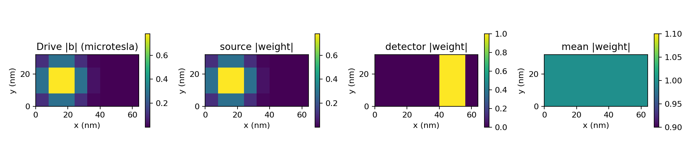
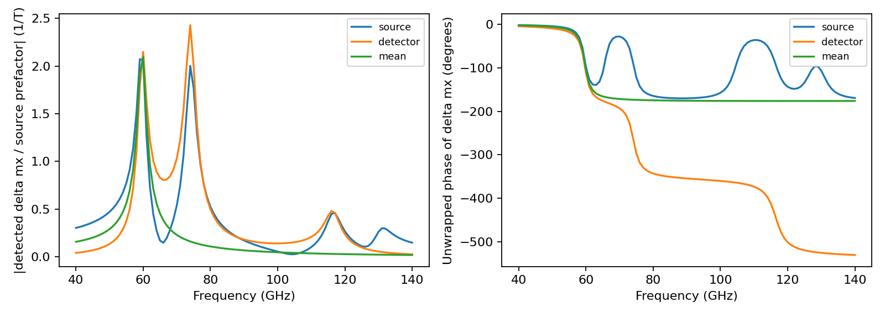
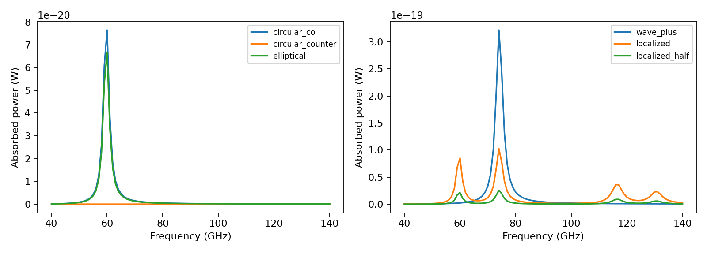

# Spatial spectroscopy qualification

Seven linear-response cases qualify the new source/probe workflow on periodic
single-layer films. The underlying exchange, anisotropy, Zeeman, demagnetizing
and LLG operators retain their existing scope. This adds measurement control,
not patterned magnetic geometry, transport or nonlinear physics.

## Checks and evidence

| Cases | Reference/check |
| --- | --- |
| Co-/counter-rotating circular and elliptical drives | Independent physical-coordinate 2 × 2 Gilbert susceptibility and total absorbed power |
| ±k plane waves with a fixed spatial phase | Independent dipole/exchange Gilbert response; matching Fourier probe; cancellation in mean/opposite probes |
| Gaussian source and rectangular/local/mean detectors | Direct shifted-system solve versus modal response using the same operator; explicit weighted observation sums |
| Half-amplitude localized drive | Half response/probe amplitude and quarter power |

All relative gates pass at **1e-10**; the largest measured comparison error is
below **4e-14**. Forbidden-probe relative amplitudes are reported separately in
[the full report](report.json) and [CSV](comparison.csv). Empty CSV cells/JSON
null indicate an inapplicable cancellation check, not an exact-zero measurement.
The co-/counter-rotating absorption ratio at the sampled co-rotating peak is
about **9314** for these parameters; it is not a general selectivity guarantee.

The localized comparison shares the discretized physical operator, so it is a
numerical cross-check rather than an independent temporal physics validation.
The analytical cases test the complex time/polarization convention, finite-k
restoring fields, absorption normalization and Fourier-probe conjugation.
The benchmark does not qualify arbitrary device geometry or source resolution.







Vector versions: [profiles](profiles.pdf), [detectors](detectors.pdf),
[spectra](spectra.pdf). Reports contain complete configurations, numerical
source/dependency fingerprints and the analysis script hash. Per-case complex
fields, weights and manifests are generated by the reproduction command.

## Reproduce

From a source checkout and a new output directory:

```bash
python -m pip install -e .
OPENBLAS_NUM_THREADS=1 OMP_NUM_THREADS=1 python benchmarks/spatial_spectroscopy.py --check
```

CI repeats the benchmark. Regression tests also cover legacy configuration
hashes/default means, schema roundtrips, empty/invalid profiles, probe names,
quadrature-drive bounds and weighted normalization across amplitude scales.
Usage, coordinates and file schemas are in the
[spectroscopy guide](../../docs/guides/SPECTROSCOPY.md).
